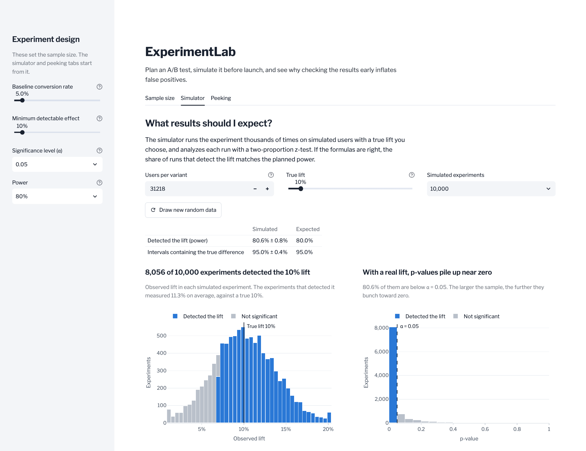

# ExperimentLab

Design, simulate, and analyze A/B tests before you run them.

ExperimentLab is an interactive A/B testing tool built in Python. It covers
the three questions that decide whether an experiment is worth running and
whether its result can be trusted:

1. **How many users do I need?** Sample size and power for a
   conversion-rate test.
2. **What results should I expect?** Monte Carlo simulation of thousands of
   experiments with a known true effect.
3. **What happens if I check early?** A demonstration of how peeking at
   results inflates the false positive rate, and how sequential testing
   keeps it under control.

It works with conversion-rate metrics (whether each user converted) and
compares two variants.

**[Open the live app](https://experiment-lab.streamlit.app)**, hosted on
Streamlit Community Cloud. If nobody has visited for a while, it opens on a
sleep page; click the button there to wake it up.



---

## Sample size calculator

Inputs are the baseline conversion rate, the minimum detectable effect (as a
relative lift), the significance level α, and the power 1 − β. The output is
the number of users needed in each variant.

The two conversion rates are converted to Cohen's h, an effect size for
proportions that stabilizes the variance, so the same formula works at any
baseline rate:

```math
h = 2\arcsin\sqrt{p_2} - 2\arcsin\sqrt{p_1}
```

The per-variant sample size for a two-sided, two-sample z-test is then

```math
n = 2\left(\frac{z_{1-\alpha/2} + z_{1-\beta}}{h}\right)^2
```

rounded up to the next whole user.

**Example.** A 5% baseline and a 10% relative lift (5.0% → 5.5%), at
α = 0.05 and 80% power, needs **31,218 users per variant**. Evan Miller's
[sample size calculator](https://www.evanmiller.org/ab-testing/sample-size.html),
which uses a slightly different variance approximation, gives 31,234. The
test suite checks results against that reference.

---

## Experiment simulator

The simulator draws synthetic control and treatment data for a chosen true
effect, runs a two-proportion test on each simulated experiment, and
summarizes the results:

- empirical power (the share of experiments that reach significance with
  treatment ahead)
- the false positive rate when there is no true effect
- the distribution of observed lifts and p-values
- confidence intervals for the difference in conversion rates, and how often
  they contain the true difference

Running the simulation at the sample size from the calculator should
reproduce the planned power, which makes the simulator a check on the
calculator as well as a teaching tool.

**Example.** Of 10,000 simulated experiments with a 5% baseline, a 10% true
lift and 31,218 users per variant, 80.0% detect the lift, matching the
planned 80% power. With no true effect, 5.1% reach significance, close to
α = 0.05. In both cases about 95% of the confidence intervals contain the
true difference. Simulating and analyzing all 10,000 experiments takes about
a millisecond.

A two-sided test can also reach significance in the wrong direction and call
a better treatment worse. Those results are not counted as detecting the
lift. At low power they are a noticeable share of significant results: with
1,000 users per variant, 7.9% of experiments are significant but only 7.2%
have treatment ahead, which is the power the calculator predicts.

Low power also inflates the effects that do reach significance. Only
experiments that happen to overestimate the lift clear the bar, so with 1,000
users per variant the ones that detect a 10% lift measure 60% on average. At
the planned 31,218 users they measure 11.4%.

---

## The peeking problem

A p-value is only valid if you look at it once, at the planned sample size.
Checking a running experiment repeatedly and stopping the first time
p < 0.05 gives chance many opportunities to cross the line.

In an A/A test both groups are identical, so every significant result is a
false positive. Checking one at equally spaced points and stopping at the
first significant result:

| Looks at the data | Stop at first p < 0.05 | O'Brien–Fleming boundaries |
|------------------:|-----------------------:|---------------------------:|
| 1                 | 5%                     | 5%                         |
| 5                 | 14%                    | 5%                         |
| 10                | 19%                    | 5%                         |
| 20                | 25%                    | 5%                         |

The middle column is computed exactly by numerical integration and matches
the published values (Armitage, McPherson and Rowe, 1969). Simulating
100,000 A/A tests with a 5% baseline and 31,218 users per variant gives the
same rates to within Monte Carlo error: 14.3%, 19.4% and 24.7%.

The correction is a set of O'Brien–Fleming boundaries. Look k of K counts as
significant only if |z| > c·√(K/k), so the bar is very high at early looks,
when little data has come in, and close to the usual 1.96 at the last one.
With five looks the thresholds are 4.56, 3.23, 2.63, 2.28 and 2.04. The
constant c is chosen so that the overall false positive rate is exactly α,
and in simulation it stays at 5.0% for 5, 10 and 20 looks. An experiment can
still stop early when the evidence is overwhelming, and one that runs to the
end is analyzed almost as if there had been no interim looks.

---

## Getting started

Requires Python 3.12 or later.

```bash
git clone https://github.com/WKS-DS/ExperimentLab.git
cd ExperimentLab
python -m venv .venv
source .venv/bin/activate        # Windows: .venv\Scripts\activate
pip install -r requirements.txt
streamlit run app.py
```

Run the tests:

```bash
pip install -r requirements-dev.txt
pytest
```

---

## Repository layout

```
ExperimentLab/
├── app.py                  # Streamlit entry point
├── .streamlit/config.toml  # Theme: colors and fonts
├── core/                   # Statistics only, no UI code
│   ├── power_analysis.py   # Sample size and power
│   ├── statistics.py       # Two-proportion z-test and confidence interval
│   ├── simulator.py        # Monte Carlo experiment simulation
│   └── sequential.py       # Repeated looks and sequential boundaries
├── ui/                     # Streamlit components
│   ├── sidebar.py          # Experiment inputs
│   ├── results.py          # Result tables and summaries
│   └── charts.py           # Plotly charts
├── tests/                  # pytest suite for core/ and the app
└── docs/screenshot.png     # README image
```

`core/` has no Streamlit imports, so every statistical function can be
tested and reused on its own.

---

## Built with

NumPy for simulation, SciPy for the statistics, pandas for results, Plotly
for charts, and Streamlit for the app. The tests use pytest and check every
statistical function against statsmodels or SciPy reference results.

---

## Roadmap

- [x] **Stage 1, statistics core:** sample size, power, two-proportion z-test,
      confidence interval
- [x] **Stage 2, simulator:** Monte Carlo experiments with a known true effect
- [x] **Stage 3, peeking demo:** repeated looks and a sequential correction
- [x] **Stage 4, working app:** all three tools connected in Streamlit
- [x] **Stage 5, interface polish:** layout, charts and explanations
- [x] **Stage 6, ship:** deployed to
      [Streamlit Community Cloud](https://experiment-lab.streamlit.app)
